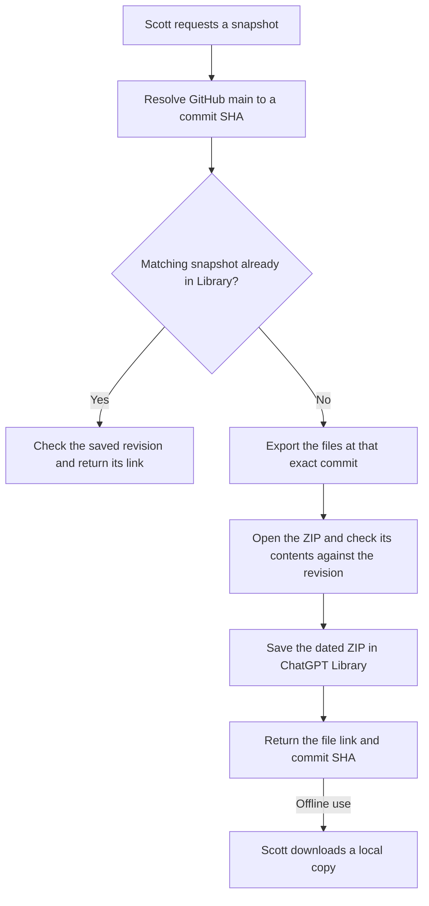

# Keep a snapshot of the published notebook

This optional flow starts when Scott asks for an archive. Its purpose is to make one known revision available as a file for offline use or later reference. The archive covers the public GitHub repository at the specified revision. Private recipe drafts and unpublished assessments stay separate.

Use a name such as `recipe-notebook-YYYY-MM-DD-<short-sha>.zip` and record the full commit SHA. A ZIP captures the files at one revision. For local work that needs branches and commit history, use a Git clone. Read live `main` before making later publication decisions because the snapshot may be older.
