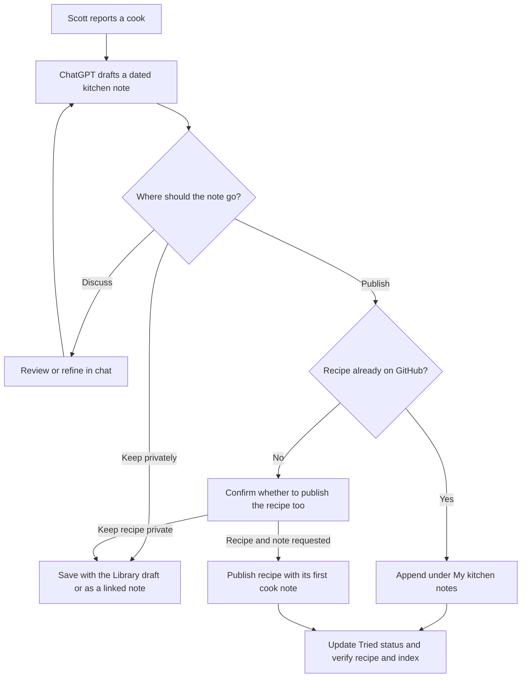

# Assess a recipe after cooking

Scott can report a cook in ordinary language. ChatGPT drafts a dated note recording what changed, what happened and what to try next time. For example, “I spread the second tray thinner and it crisped up better” is useful evidence for the next cook. Keep personal and family details out of the public note unless Scott explicitly asks to include them.

Use the cook date if known. If only the report date is known, label it as such. Preserve the creator's method alongside Scott's observations. A confirmed cook supports a **Tried** update even if the dish turned out poorly.
