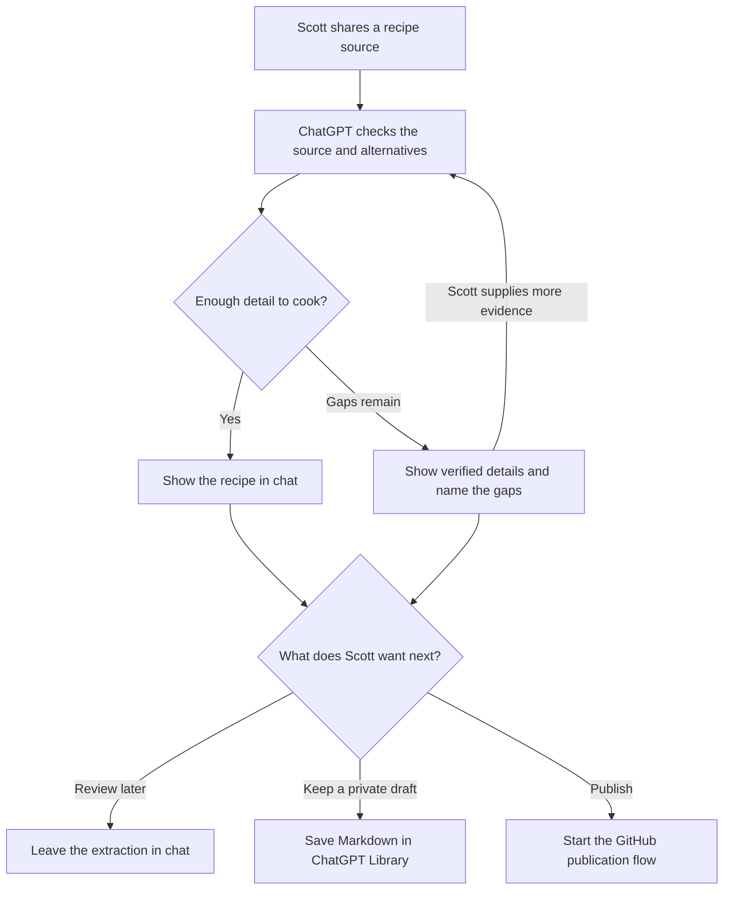

# Extract a recipe and keep a draft

A bare recipe link starts an extraction. The same flow works for a recording, screenshot or recipe page. ChatGPT checks the current [recipe guidance](../recipe-guidance.md), gathers the available evidence and shows a cookable recipe or a clearly labelled partial extraction.

“Keep this as a private draft” gives the recipe a durable file before publication. Use one Markdown file per draft with the source link, the extraction and any open questions. Return the file link so Scott can resume from it later. A plain “save this” follows the project's existing [publication flow](publish.md).
