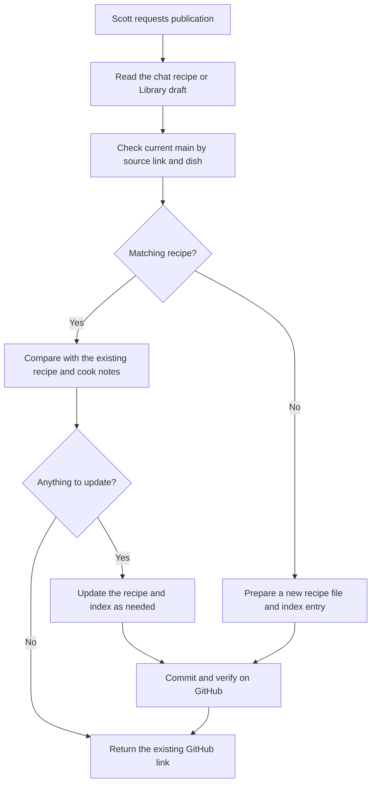

# Publish a recipe to GitHub

Start here when Scott asks to add, save or publish a recipe to the notebook. A chat extraction and a private Markdown draft are equally valid starting points.

Keep source attribution and meaningful uncertainties. Check for useful [kitchen pairings](../recipe-guidance.md#kitchen-pairings). After a write, read back the recipe and check its README link on `main`. GitHub holds the published version. If an earlier Library draft turns up later, compare it with the live recipe before using it.
